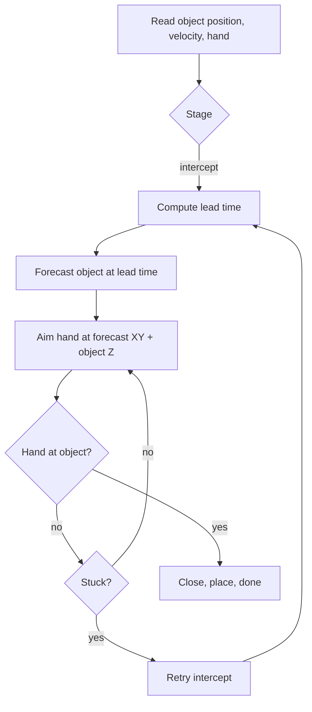

# Foresight research

**Goal** (from `foresight_plan.md`): flat pick-and-place success from **0 to 0.20 m/s**, in sim and on the real robot. Speeds of 0.5–1.0 m/s are stretch targets, attempted only after the scripted expert clears them.

Tags: **[fact]** measured, **[calc]** derived, **[lit]** from papers, **[interp]** our reading.

---

## 1. The system today

### 1.1 Stack
- **Policy:** SmolVLA. The vision encoder (SigLIP) and the first 16 language-model layers are frozen; only the action expert and the state projection are trained. It predicts 50 actions per call, and eval runs the first 8 (0.32 s) before planning again. [fact]
- **Input numbers, every 25 Hz step:** 8 robot numbers plus 4 object numbers: where the object will be in Δ = 0.25 s ($\hat p_x, \hat p_y$) and its velocity ($\hat v_x, \hat v_y$). Planned: add Δ itself as a 13th input, so the policy can handle varying delay. [fact / plan]
- **Language:** one template, "Pick the {object} and place it in the {container}". Every demo has one object and one container, so the instruction never has to choose anything. [fact]
- **Data:** 5,568 episodes (~630k frames) at 0 / 0.10 / 0.15 / 0.20 m/s. [fact]
- **Expert (teacher):** our own scripted state machine (`sim/state_machine.py`, section 4). Limits: section 5. Success is judged by our own rule, not DynamicVLA's.

### 1.2 Measured behaviour (V2 checkpoint)

| Test | Result | Counts as evidence? |
|---|---|---|
| Offline: shift the object numbers by 3 cm | Aim moves **0.96 / 0.85** of the shift | Yes |
| Offline: shift the hand position | Aim moves **0.01 / 0.06** (the old copycat model: ~1.0) | Yes |
| Closed loop: object numbers +3 cm | Hand follows ~0.78 of the shift; success drops as expected | Yes |
| Numbers set to zero | 0/30 | **No.** Zeros are outside the training data |
| Wrong object name, or grey wrist image | Still succeeds | Shows language and wrist camera are barely used |
| **Tracker input, n = 80**, at 0 / 0.10 / 0.15 / 0.20 m/s | **95 / 81 / 63 / 46%** | Not flat |
| True object state + close rule, n = 40 | Up to **100 / 100 / 95 / 85%** | Sim truth only |
| Scripted expert (true state, with retries) | ~88 / 83 / 78 / 72% | Ceiling for any claim |
| Tracker error | Median ~0.4 cm far from the hand; 2–5 cm near the grasp | Occlusion and bias |

### 1.3 What this means
**Gates** (names starting with **G-**) are pass/fail checks before a paper claim — **not** “ground truth.” Full rules: section 8.2.

| Question | Answer |
|---|---|
| Do the object numbers help? | **Yes.** 69% with numbers vs 3% without, same data and budget, at 0.20 m/s (**G-claim** passed: “explicit state helps”) |
| Does the instruction choose the object? | **No** (**G-VLA** failed: “language picks the object”). Call it a *visuomotor policy driven by explicit object state*, not a language-conditioned vision–language–action model |
| Does the close-timing layer help? | Mainly under delay: 42 → 70% with 100 ms added (**G-timing**: “is the close layer worth keeping?”) |
| Highest claimable speed? | **0.20 m/s** today under **G-speed** (“claim a speed only if the scripted teacher ≥ 90% there”). That bar can rise if the teacher is fixed — see section 5 |
| Is the capture model $P_s$ better than a distance rule? | Not shown in closed loop. Not a headline claim. ($P_s$ = probability the object will sit inside the fingers at contact; see 3.2) |
| Can we drop the filter? | No (section 3.4). Renaming it an "N-frame fit" changes nothing |
| Under 100 ms per cycle? | Yes, on the 4090, with software only (section 3.6) |
| 95% at 1 m/s? | Unproven. Needs new gripper fingers, a fast servo and prediction, not a bigger GPU |

Full results: `data/eval/PLAN_V2_RESULTS.md`.

---

## 2. Why it works the way it does (ranked)

1. **Language is unused.** With one object per scene, the instruction carries no information about the action. A bigger or unfrozen VLM cannot fix that; only two-object data, or a detector that picks the target (Design A, section 6.1), can. [fact]
2. **Vision is weak for aiming.** The numbers are a cheaper signal; the static image is used mostly to find the container. [interp]
3. **Copycat, fixed in V2.** Old demos let "hand + offset" predict the next action. Training with hand noise fixed it, and the probe confirms it. [fact]
4. **The drop with speed has separate causes:** close timing and alignment, the object stalling against the fingers before the close (a sim artifact), tracker error near the grasp, and uncompensated delay plus chunk age. [fact]
5. **Above ~0.25 m/s, the slow policy alone runs out of room to miss.**  
   Plain picture: the learned policy updates only ~25 times per second, and each update often runs several actions before looking again (an “8-step chunk”). In that blind stretch the object keeps moving.  
   **Slack** = leftover gap for aim error ≈ (how wide the fingers open − how wide the object is) / 2. For a stock hand on a fat fruit that is only ~**5 mm**. At higher speed, motion between updates is bigger than that 5 mm, so the fingers miss.  
   **Ways out (any one helps; combine for higher speed):**  
   - use a **smaller object** or a **wider / funnel / soft gripper** → more slack, so a larger miss still catches;  
   - or add a **fast servo** (≥ ~100 updates/s) that only tracks the hand–object gap in the last ~10 cm, while the slow policy still sets the big plan. [calc]

---

## 3. The math that drives the design

### 3.1 Delay and contact error
If the robot acts on a picture that is $\tau$ seconds old, it misses by

$$e \approx v\,\tau$$

At 1 m/s and $\tau = 100$ ms that is **10 cm**; even 50 ms (camera + motor only) is **5 cm**. No GPU removes this; only prediction does.

The error across the fingers at contact adds up from five sources:

$$\sigma_n^2 \approx \underbrace{\big(v_n(1-m)\,t_c\big)^2}_{\text{drift while closing}} + \underbrace{(v\,\sigma_\tau)^2}_{\text{timing jitter}} + \underbrace{(\sigma_v\,\Delta t)^2}_{\text{velocity error}} + \underbrace{\big(\tfrac12 a\,\Delta t^2\big)^2}_{\text{deceleration}} + \underbrace{\sigma_{\text{pos}}^2}_{\text{position error}}$$

Here $m$ is how well the hand matches the object's speed (1 = perfectly), $t_c$ the close time, $\sigma_\tau$ the timing jitter, and $\Delta t$ the remaining prediction horizon. Without delay compensation, add $(v\,\tau)^2$, which usually dominates.

| Case | Typical miss | Slack | Verdict |
|---|---|---|---|
| 0.20 m/s, compensated | ~4 mm | 5 mm | Marginal; matches the mid-80s % |
| 0.50 m/s, motion across the fingers | ~8 mm | 5 mm | Fails |
| 0.50 m/s, pads along the motion | ~8 mm | ~20 mm | Works |
| 1.0 m/s, compensated, $\tau = 100$ ms | ~7 mm | 5 mm | Fails on a stock gripper |

### 3.2 Capture region
A two-finger grasp succeeds only if the object is inside the fingers' capture region $\mathcal C$ at contact. The capture probability is

$$P_s(t) = \Pr\big(e(t + t_{\text{contact}}) \in \mathcal C \mid \text{what we know at } t\big)$$

- **Offline [fact]:** $P_s$ predicts success well (AUC ~0.97); relative speed alone does not (AUC ~0.57).
- **Closed loop [fact]:** closing on $P_s$ beats the policy's own close, but **not** a simple distance rule (p ≈ 0.07–0.55). Keep the distance rule plus latch as engineering; don't claim $P_s$ is better.

**A bigger capture region is the cheapest lever.** With aim error $\sigma = 2$ cm and capture radius $R$:

$$P\big(\lVert e\rVert < R\big) = 1 - e^{-R^2/(2\sigma^2)}$$

A pinch grasp ($R = 1.5$ cm) gives ~25%; soft or funnel fingers ($R = 5$ cm) give ~96%. [calc]

### 3.3 Drift between re-plans
At 25 Hz each step lasts 40 ms, so at 1 m/s the object moves **4 cm per step** the robot runs without looking. An 8-step chunk is **32 cm** of blind travel. Staying within 2 cm needs a fresh decision every 20 ms or less, which means a fast inner servo, not a faster policy. Inference under 100 ms helps only if it raises that rate. [calc]

### 3.4 Why the filter stays
Velocity from $N$ frames spaced $T$ apart, each with position noise $s$, has variance

$$\operatorname{var}(v) = \frac{12\,s^2}{T^2\,N\,(N^2-1)}$$

No estimator, including a neural network, can beat this bound on the same frames (the Cramér–Rao bound). Our Kalman filter already sits at it. A 2-frame network is much worse (~21 mm vs ~5 mm at a 0.25 s horizon). "Learning motion from frames" moves the same estimate inside the network; it does not loosen the physics. [calc]

### 3.5 Statistics for claims
- Scout with n = 20 per speed; claim with **n ≥ 80 per speed**, using Wilson intervals.
- Claiming "flat ≥ 95%" with a lower bound ≥ 90% needs **n ≈ 139 per speed** if the true rate is ~95%.
- The policy cannot beat the expert at that speed. If the expert's ceiling is 90%, a 95% claim is impossible.

### 3.6 Inference budget
Total delay is perception + inference + actuation:

$$\tau = L_p + L_i + L_a < 100\ \text{ms}$$

With camera and motor at ~50 ms, inference must stay under ~50 ms.
- **Measured:** CUDA-graphed flow loop with 5 steps gives a ~57 ms cycle on the RTX 4090.
- After that, an H100 saves only ~1–6 ms, so it is not the fix. [calc]
- Spend in this order: software (graphs, fewer steps) → delay prediction → soft/funnel fingers → event camera (for throws) → bigger GPU last.

---

## 4. Scripted expert (sim)

Code: `sim/state_machine.py`; settings: `sim/phase0_cfg.yaml` → `state_machine_params`. Normal path: start → intercept → close → lift → place → home (stage 2 is unused).

- **Lead time:** iterate travel time against the forecast (capped at ~0.25 s), then add `tau`, the delay between command and motion. The hand aims **ahead** so that the lag lands it on the object. Close to the object, travel time goes to zero and the hand rides along with the object.
- **"Hand at object?"** (`grasp_xyz_ok`) compares the hand with the object's **current** position, not the aim point.
- **Bounce guard:** don't close if the object will hit a wall first.

---

## 5. Teacher issues (scripted expert limits)

**Teacher** = the scripted expert in `sim/state_machine.py` (also called the expert or the collector). It is the program that moves the arm in demos and that sets the **ceiling**: how well a perfect imitator could do if it copied that teacher.

**Why this section exists.** Gate **G-speed** says: do not claim a learned policy at a speed where the teacher already fails. That is fair — but the teacher has bugs and design limits. **Fix the teacher, re-measure the ceiling, then raise the claim.** Fixing the teacher does *not* remove physics (delay, finger size, arm acceleration); it only raises the bar that is under our control.

Measured teacher success with true object state and retries (approx.): **~88 / 83 / 78 / 72%** at 0 / 0.10 / 0.15 / 0.20 m/s. Clean runs without retry are lower. The ≥ 90% “claimable” line holds only through **0.20 m/s** today.

### 5.1 Issues that cut success as speed rises

| # | Issue (plain words) | What goes wrong | How to fix (teacher / scene) |
|---|---------------------|-----------------|------------------------------|
| 1 | **No fast inner loop near contact** | The expert mostly commands at the same slow rate as the rest of the sim (~25–50 commands per second). At 0.5 m/s the object moves centimetres between commands, so the fingers cannot stay centred. | Add a **servo**: a small fast controller (≥ 100–250 updates per second) that only holds hand–object gap in the last ~10 cm. That is experiment **E6**. |
| 2 | **Approach takes too long** | Lead time is capped (~0.25 s look-ahead). Models of intercept show that if the hand starts late (order ~1–2 s travel), many throws become unreachable at 1 m/s. | Plan the intercept once, stream a faster path; shorten time-to-first-motion; pre-position the hand earlier. |
| 3 | **Finger pads face the wrong way** | Two-finger grippers have a wide “pad” direction and a tight “closing” direction. If the object slides **across** the narrow gap, a few millimetres of error miss. If it slides **along** the pads, the same error often still catches. | Rotate the hand so pads line up with the object’s velocity before close (code already has yaw helpers; use them on every throw direction). |
| 4 | **Sim “stall before close” artifact** | In some collects the object is held still (pose-scripted / immovable) while the fingers push against it. That teaches bad timing and inflates or warps success. | Keep the object free to move until the grasp finishes. |
| 5 | **Tiny capture window (stock pinch)** | Opening minus object width leaves only ~5 mm slack per side on small fruit. Aim and timing must be almost perfect. | Wider or funnel / soft fingers for high-speed work; keep stock pinch only for the 0–0.20 m/s claim. |
| 6 | **Gripper close is slow** | Fingers take tens of milliseconds to shut (sim often ~80 ms; a real Franka hand can be slower). The object keeps moving during that time. | Measure real close time; match hand speed to object speed while closing; trigger close earlier by that delay. |
| 7 | **Weak velocity matching at contact** | If the hand is nearly stopped and the object is still sliding, the object can slip out of the pads during the close. | Feed-forward object velocity into the hand command; servo holds relative speed near zero. |
| 8 | **Lag pad `tau` may not match real lag** | `tau` ≈ approach pad + one control step: a guess of “command now → motion later.” If the guess is wrong, the hand aims ahead of or behind the object. | Measure command→motion delay on the real stack; set `tau` (and train-time Δ) from that number. |
| 9 | **Constant-speed / kinematic object in sim** | Many demos move the object at constant velocity. Real slides decelerate; throws are ballistic. A teacher tuned on constant speed aims wrong on real motion. | Add friction / deceleration and throw physics in the expert’s forecast; test both. |
| 10 | **Retries hide misses** | On a miss, the expert goes back to intercept (bounded retries). Reported success with retries looks higher than a single-shot policy. | Always report **clean (no retry)** and **with retry** separately; policy claims should match the no-retry bar unless the policy also retries. |
| 11 | **Bounce / wall timing** | Closing is blocked if a wall hit comes first; some throws never get a legal close window. | Better bounce forecast; choose catch points earlier; reject hopeless throws from the claim set and report that filter. |
| 12 | **Top-down grasp only** | Orientation is mostly “fingers down,” maybe yaw. Tilted or spinning objects need more orientation control. | Add yaw (and later pitch) selection from object shape / motion; out of scope until planar high-speed works. |
| 13 | **Lift / carry / place stalls** | After a grasp, stages can time out (“lift stalled,” “carry stalled”) and go home as failure even if the pinch was fine. | Tune lift heights and timeouts; check grip force / torsion in sim (carry slips are not always a “squeeze harder” problem). |
| 14 | **Oracle teacher vs noisy sensors** | Ceiling numbers above use **true** sim object state. A teacher that must use the camera tracker will score lower. | Measure a **tracker-fed expert** ceiling too; that is the fair bar for a policy that uses the tracker. |
| 15 | **No wrist depth in the teacher loop** | The scripted expert uses ground-truth object pose, not a wrist camera fit. It never practices recovering from occlusion the way the policy must. | Optional: run a teacher variant that closes from wrist estimate for demos meant to teach that skill. |
| 16 | **Arm acceleration / workspace limits** | Matching 1 m/s can need hard accelerations and leave little room to brake. If the arm cannot reach the intercept in time, the teacher fails even with perfect aim math. | Pre-position; reject unreachable throws; verify real robot speed/accel limits (do not trust recalled datasheet numbers alone). |
| 17 | **Impact and bounce on contact** | Hard pinch at high relative speed can knock the object away. Soft-catch literature succeeds by “moving with” the object briefly. | Soft pads, short follow-through before clamp, or a cup/funnel for stretch speeds. |
| 18 | **Throw direction diversity** | Random throws that leave the workspace or cross the fingers the hard way dominate failures; a “realistic throw” subset looks much better. | Fix pad alignment and intercept for all directions; always publish the **full** distribution next to any filtered subset. |

### 5.2 What is *not* a teacher bug
- **Camera tracker error** near the hand (2–5 cm) — that is perception, not the scripted controller (unless you feed the tracker into the teacher; see #14).
- **Policy copycat / ignored language** — those are learning/data issues, not expert motion bugs.
- **Buying a bigger GPU** — does not raise the teacher ceiling.

### 5.3 Rule after fixes
1. Change one teacher/hardware lever (servo, pads-along, free object, fingers, measured `tau`).
2. Re-run the scripted expert at each speed (**E6**), with and without retries, true-state and tracker-fed if both matter.
3. New **G-speed** line = highest speed where teacher success ≥ 90% (pre-register n, e.g. ≥ 40 scout then ≥ 80 to claim).
4. Only then collect policy demos at that speed.

---

## 6. What to build

### 6.1 Recommended design

| Layer | Job | Rate |
|---|---|---|
| **Target choice** (optional) | **Design A:** parse the instruction; an open-vocabulary detector (a pretrained model that finds objects from text) picks **one** tracked blob; only that object's numbers go to the policy | Once per episode |
| **Estimation** | Multi-frame filter or fit; outputs position, velocity, uncertainty, timestamp, valid; predicts ahead by the measured delay Δ | ≥ 25 Hz |
| **Slow policy** | Frozen vision–language backbone + object numbers (+ Δ); plans asynchronously | 8–25 Hz, under 100 ms per cycle |
| **Fast servo** | Follows an object-relative goal in the last ~10 cm | ≥ 100–250 Hz when slack is tight (~5 mm); less critical if the gripper is much wider than the object |
| **Close** | Distance rule plus latch (once closing starts, stay closed), compensated for gripper time and lag | On trigger |
| **Fingers** | Stock pinch OK if objects stay small vs opening; wider / funnel / soft fingers if you want higher speed without a perfect servo | Hardware |

### 6.2 What not to fund as the main path

| Idea | Why not |
|---|---|
| Bigger end-to-end vision–language–action model, trained longer on the same demos | The data has no language signal; no evidence at 1 m/s; DynamicVLA-class models reach ~47% on 0–1 m/s [lit] |
| Drop the multi-frame motion estimate | Delay math and the estimation bound (3.1, 3.4) rule out 95% pinch grasps at 1 m/s |
| Latent video world model as the only predictor | Best case ~95% only up to ~0.4 m/s (AHEAD paper), with 150–200 ms latency [lit] |
| Unfreeze vision to "fix the cameras" | The swap/shift probes show the policy already aims with the numbers; vision isn't the bottleneck |

### 6.3 Stretch: ≥ 1 m/s and ≥ 95% flat
- **No verified precedent** for pinch-grasp-and-place at that level. [lit]
- Catching systems with cups or nets reach ~80–85% at several m/s; event-camera catchers ~81–83% at 13–15 m/s. Neither is the same task. [lit]
- In our models a stock hand tops out at ~0.80–0.88 at 1 m/s. Funnel fingers with ~2 ms timing jitter, or soft fingers with capture radius $R \approx 5$ cm, can get the grasp itself to ≥ 0.95. [calc]
- Path: funnel/soft fingers + multi-frame ballistic prediction + ≥ 250 Hz servo + target chosen once. A GPU upgrade comes last.

---

## 7. Literature in one table

| Group | Takeaway |
|---|---|
| SmolVLA, π0, OpenVLA | Freezing the backbone and training only the expert is normal for SmolVLA; OpenVLA often trains vision too. Language use has to be **tested**, not assumed |
| Shortcut learning | Copycat and causal confusion are known failure modes; DART adds noise during collection |
| Moving-object VLAs (DynamicVLA, AHEAD, Reflex, DSDyn, …) | Latency handling and look-ahead help; **none** shows ≥ 1 m/s together with ≥ 95% |
| Explicit future pose (SIDO, PAF-Grasp) | Closest relatives; real conveyors mostly ≤ 0.2 m/s |
| Two-speed / async control (HiRT, FLASH, RTC, Helix, …) | Borrow the slow-planner + fast-controller split; HiRT's "dynamic" tasks are ~1 cm/s |
| Classical catching | Filter or ballistic model plus fast re-planning, usually with a cup or net |
| Soft or caging hands | Enlarge the capture region; buy centimetres of tolerance |

**What is still novel:** measured proof that the policy uses the object state (swap/shift tests, not zero-out), flatness reported with confidence intervals, and a written error budget linking speed, delay and slack. "Conditioning on the future" alone is already published.

---

## 8. Experiments and gates

**Experiment IDs (E0, E1, …)** are just short labels for the tests below — not “epoch” or “expert.”  
**Gate IDs (G-…)** are pass/fail rules before a claim — **not** “ground truth.”

### 8.1 Experiments (smallest decisive set)

| ID | What we run | What it decides |
|---|---|---|
| **E0** | Offline: nudge object numbers, hand pose, images, or the instruction text; see how much the predicted aim moves | What the network actually reads |
| **E1** | Closed loop: swap in another episode’s object numbers, or shift them a few centimetres (replaces “set numbers to zero”) | Whether it really uses the state |
| **E5** | Train a same-size model with **no** object numbers | The central claim “explicit state helps” |
| **E4** | Turn close-timing / delay compensation / tracker input on and off | Whether to keep the close layer |
| **E2** | New objects, new table worlds, speeds not in training | Generalization |
| **E3** | Two objects on the table; the sentence names one | Whether “vision–language–action” is earned |
| **E6** | Scripted teacher + fast servo (≥ 100 updates/s near contact); measure success vs speed | Highest **claimable** speed after teacher fixes (section 5) |

Order: E0 → E1 → E5 → E4 → E2, then E3 and E6 when needed.

### 8.2 Gates (explained)

| Gate name | Plain meaning | Pass rule |
|---|---|---|
| **G-claim** | “May we say the object numbers help?” | Experiment E5: model with numbers beats no-numbers by ≥ 15 percentage points at 0.20 m/s (statistical test p < 0.05) |
| **G-VLA** | “May we call this a vision–language–action system that follows words?” | Experiment E3: ≥ 90% correct object chosen from the instruction (try frozen backbone first; only then try LoRA = low-rank adapters, a cheap way to train a few extra weights) |
| **G-timing** | “May we keep the close-timing software layer?” | Experiment E4: ≥ +5 percentage points vs the best baseline, and it adds under 5 ms |
| **G-speed** | “May we claim success at this object speed?” | Experiment E6: scripted teacher success ≥ 90% at that speed (after teacher fixes in section 5, this line can move up) |
| **G-scale** | “May we unfreeze the big vision net or switch to a much larger model?” | Only if language grounding or held-out grasps still fail while object numbers are accurate and training loss shows the small model is not under-capacity |
| **G-simplify** | “Should we delete a module?” | Yes if turning it off does not hurt within the confidence interval |

### 8.3 Data changes (only when E0–E5 call for them)
- Two-object scenes recorded in pairs, so the instruction is the only difference.
- Let the object move under the fingers before the close, to remove the stall artifact (section 5.1 #4).
- Sample delay Δ during training; log timestamps; add deceleration and direction variety.
- Size the dataset from a learning curve, not a guess. Collect high-speed demos only where the teacher already clears **G-speed**.

### 8.4 Paper framing (only what the results support)
> Explicit filtered object state fed to a small frozen-backbone visuomotor policy, plus a delay-aware close and servo, gives near-flat pick-and-place from 0 to $v_{\max}$ on simple objects. It is cheaper and easier to test than latent world-model vision–language–action systems, and in-distribution counterfactuals prove the policy uses the state.

- $v_{\max}$ = **0.20 m/s** until E6 (after teacher fixes) says otherwise.
- Report the full throw distribution next to any "realistic throw" subset.
- Leave out: zero-out as proof, $P_s$ beating distance, and "the model follows language" until E3 passes.

---

## 9. Next steps (cheapest first)

1. Keep the swap/shift probes; never use zero-out as evidence.
2. Test the CUDA-graphed loop with 2, 3 and 5 flow-matching steps in closed loop at 0.20 m/s, against 10 steps. (Flow matching = the action expert’s denoising steps; fewer steps = faster inference.)
3. Add Δ to the live input; measure the real perception, inference, actuation and gripper times.
4. Fix the highest-impact teacher issues in section 5 (servo, pads-along, free object), then run **E6** before any 0.5–1.0 m/s policy collect.
5. Test the Design A detector on two-object renders before any language re-collection.
6. For ≥ 1 m/s: funnel or soft fingers and timing hardware before any model scaling.

---

The plan of record for runtime and phase gates (G0–G4 in `foresight_plan.md`) is still that file plus `AGENTS.md`. This document replaces the earlier notes in `foresight_docs/`.
