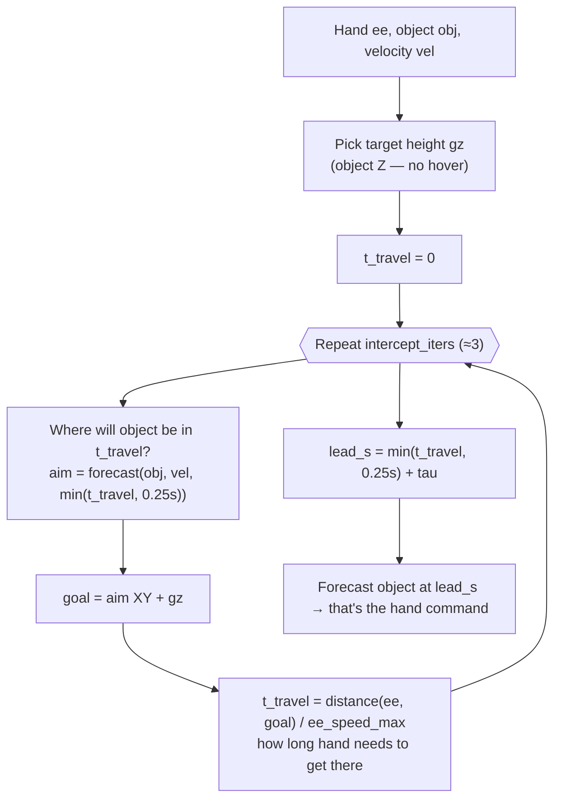
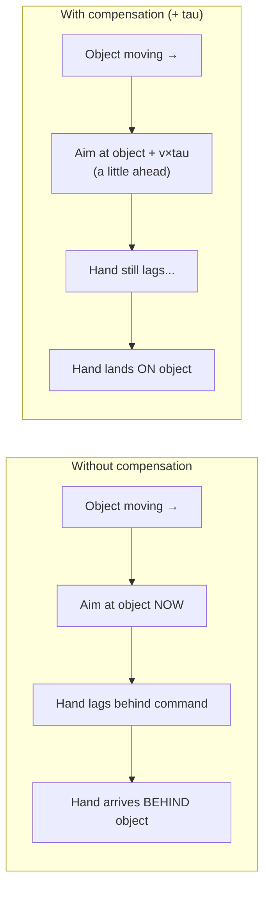
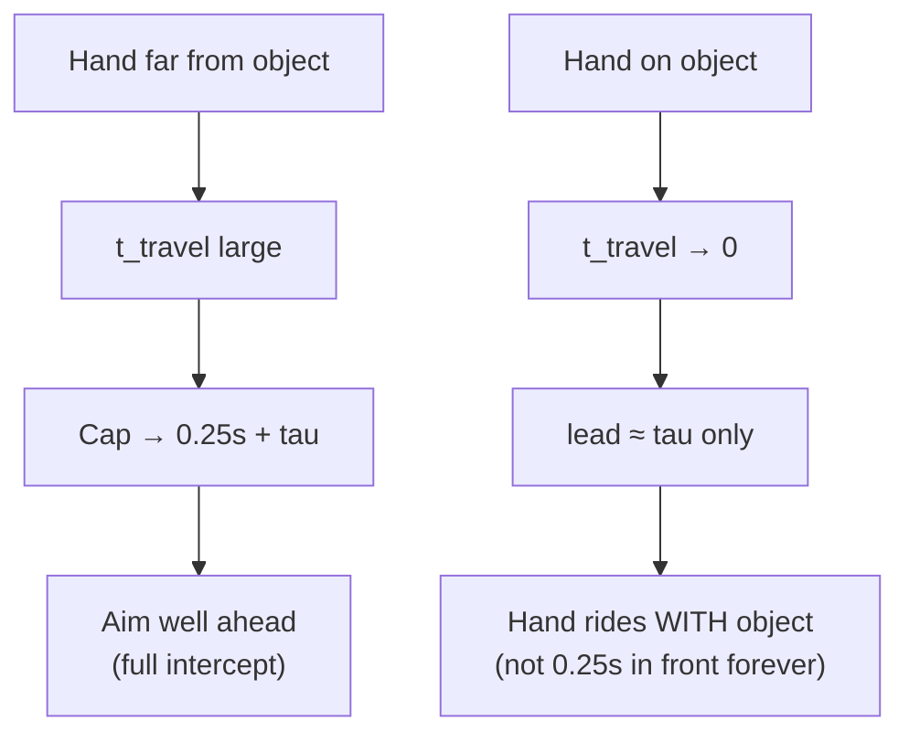

# Intercept-servo flow diagrams

Plain guide to how the expert chases a moving object. Code: [`sim/state_machine.py`](../sim/state_machine.py).

---

## One sim step (stages 0–9)

Happy path skips stage 2: intercept (1) closes straight to close (3).

```mermaid
flowchart TD
    A[Read object pos + vel + hand pos] --> B{Which stage?}

    B -->|0 start| S0[Wait settle_s]
    S0 --> S1

    B -->|1 intercept| S1

    S1 --> L1["Compute lead time lead_s<br/>_intercept_lead_s()"]
    L1 --> L2["Forecast object at lead_s<br/>(with wall bounces)"]
    L2 --> L3["Aim hand at forecast XY + object Z"]
    L3 --> L4{grasp_xyz_ok<br/>GT |dx|,|dy|,|dz|}
    L4 -->|no| L5{Stuck too long?}
    L5 -->|yes| RET["Re-intercept (retry)"]
    L5 -->|no| L3
    L4 -->|yes| BG{Bounce clear?<br/>enough time before wall hit}
    BG -->|no| L3
    BG -->|yes| S3["Log grasp_err, grasp_speed"]

    B -->|2 go down unused| U2["Same chase as stage 1<br/>(happy path skips)"]
    U2 --> L4

    B -->|3 close| S3
    S3 --> S4[lift → carry → lower → open → home → done]

    RET --> S1
```

---

## Inside `_intercept_lead_s` (meet-up solver)

Code: [`_intercept_lead_s`](../sim/state_machine.py) in `state_machine.py`.



---

## What `tau` does (lag compensation)

`tau` ≈ `robot_approach_pad_s + dt` — pad on aim for tip lag (command → motion). We aim **ahead** so lateness puts the hand **on** the object, not behind it. The object speed is **not** slowed down.



---

## Far vs close (why lead shrinks)



---

## Legend

| Term | Plain meaning |
|------|----------------|
| **forecast** | Roll object forward in time (same bounce rules as sim) |
| **lead_s** | How many seconds ahead we look when aiming |
| **tau** | Arm delay — command arrives before motion catches up |
| **grasp gate** | Hand inside `grasp_xyz_ok` on the object *now* (not on the aim point) |
| **bounce guard** | Don't close if object will hit a wall before the grasp finishes |

---

## Related docs

- **`step()` function (all stages):** [`step-function-flow.md`](step-function-flow.md)
- Full stage walkthrough: [`sim/STATE_MACHINE.md`](../sim/STATE_MACHINE.md)
- Knobs: [`sim/phase0_cfg.yaml`](../sim/phase0_cfg.yaml) → `state_machine_params`
