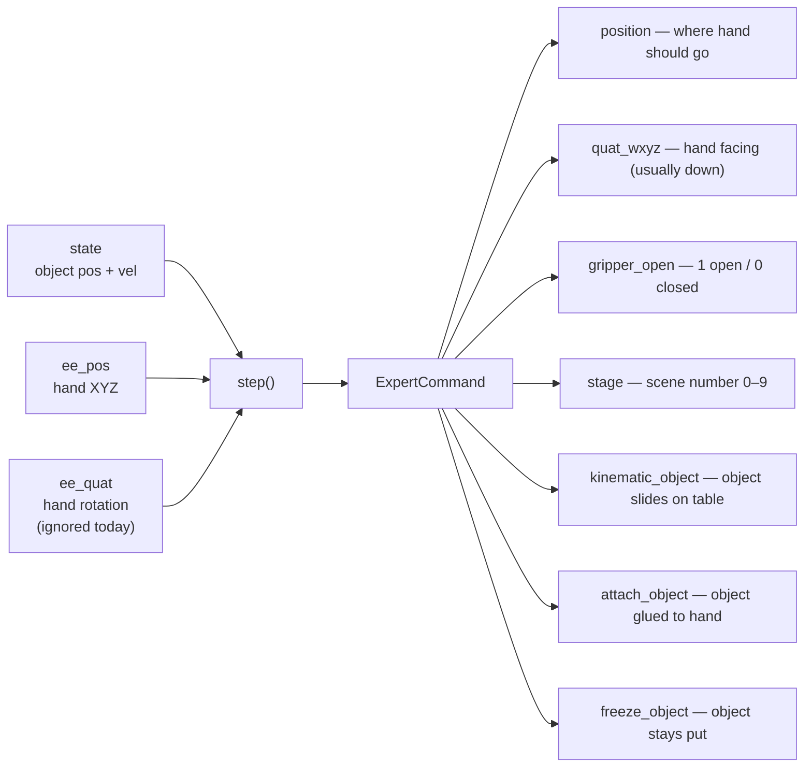
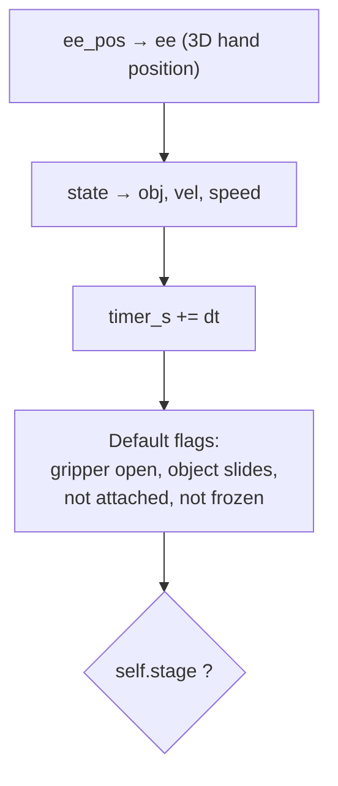
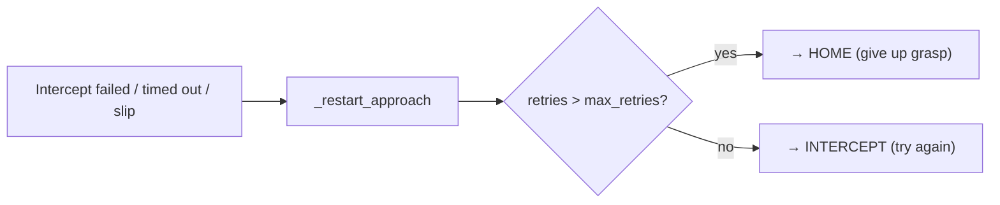

# `PickPlaceStateMachine.step()` flow

Code: [`sim/state_machine.py`](../sim/state_machine.py) (`PickPlaceStateMachine.step`).

Called once per sim tick from [`collect.run_episode`](../sim/collect.py).

---

## What goes in / what comes out



**Plain words:** read object + hand → pick next hand target and object mode → scene executes it.

---

## Top of every `step()` call



`ee_quat` is passed in for logging / future use but **not used** in decisions.

---

## All stages (main flow)

Happy path: `0 → 1 → 3 → 4 → 5 → 6 → 7 → 8 → 9`.  
Stage **2 (go down)** is unused; intercept closes on the same `grasp_xyz_ok` gate.

```mermaid
flowchart TD
    START([step called]) --> READ[Read ee, obj, vel, speed]
    READ --> SW{stage}

    SW -->|0 start| R0["Target: arm home pose"]
    R0 --> R1{timer ≥ settle_s?}
    R1 -->|yes| R2["→ stage 1 INTERCEPT"]
    R1 -->|no| OUT

    SW -->|1 INTERCEPT| I0["lead_s = _intercept_lead_s<br/>aim = forecast at lead_s<br/>target Z = object Z"]
    I0 --> I1{grasp_xyz_ok<br/>GT |dx|,|dy|,|dz|}
    I1 -->|no| I2{grasp_stage_timeout?}
    I2 -->|yes| RET["_restart_approach"]
    I2 -->|no| OUT
    I1 -->|yes| I3{bounce_clear?}
    I3 -->|no| OUT
    I3 -->|yes| I4["Log grasp_err, grasp_speed<br/>→ stage 3 CLOSE"]

    SW -->|2 GO DOWN unused| U0["Same chase logic as stage 1<br/>(happy path never enters)"]
    U0 --> I1

    SW -->|3 CLOSE| C0["Gripper closed, attach object"]
    C0 --> C1{timer ≥ close_gripper_s?}
    C1 -->|yes| C2["→ stage 4 LIFT"]

    SW -->|4 LIFT| L0["Raise to lift_z at grasp XY"]
    L0 --> L1{At lift height?}
    L1 -->|yes| L2["→ stage 5 CARRY"]
    L1 -->|timeout| L3["→ stage 8 HOME"]

    SW -->|5 CARRY| Y0["Fly to box XY at carry clearance Z"]
    Y0 --> Y1{At carry pose?}
    Y1 -->|yes| Y2["→ stage 6 LOWER"]
    Y1 -->|timeout| Y3["→ stage 8 HOME"]

    SW -->|6 LOWER| W0["Move to _drop_target inside box"]
    W0 --> W1{At drop pose?}
    W1 -->|yes| W2["→ stage 7 OPEN"]
    W1 -->|timeout| W3["→ stage 8 HOME"]

    SW -->|7 OPEN| O0["Gripper open, freeze object in box"]
    O0 --> O1{Released + in container?}
    O1 -->|yes| O2["→ stage 8 HOME"]
    O1 -->|timeout| O3["→ stage 8 HOME"]

    SW -->|8 HOME| H0["_home_target: retreat straight up, climb, then home"]
    H0 --> H1{At home + object in box?}
    H1 -->|yes| H2["→ stage 9 DONE"]

    SW -->|9 DONE| X0["Hold home, object frozen"]

    RET --> I0
    R2 --> OUT
    I4 --> OUT
    C2 --> OUT
    L2 --> OUT
    Y2 --> OUT
    W2 --> OUT
    O2 --> OUT
    H2 --> OUT
    X0 --> OUT

    OUT["Log if stage changed"] --> CMD["return ExpertCommand"]
```

---

## Stage 1 INTERCEPT (detail)

```mermaid
flowchart TD
    A[Measure hand / object] --> B["target_z = object Z<br/>(no hover)"]
    B --> C["_intercept_lead_s(ee, obj, vel, goal_z)"]
    C --> D["_forecast(obj, vel, lead_s) → aim XY"]
    D --> E["target = aim XY + target_z"]

    E --> F{_grasp_gate_ok?<br/>|dx|,|dy|,|dz| or wrist depth}
    F -->|no| OUT[Keep intercepting]
    F -->|yes| K{_bounce_clear?}
    K -->|no| OUT
    K -->|yes| L["Log grasp stats → CLOSE (3)"]
```

---

## Stage 2 GO DOWN (unused)

Id kept for old logs / failure labels. Happy path never enters it. If entered, the same branch as stage 1 runs (`STAGE_APPROACH` and `STAGE_DESCEND` share code).

---

## Object + gripper flags by stage

| Stage | gripper | object slide | attach | freeze |
|------:|:-------:|:------------:|:------:|:------:|
| 0–1 start / intercept (2 unused) | open | yes | no | no |
| 3 close | **closed** | no | **yes** | no |
| 4–6 lift / carry / lower | closed | no | yes | no |
| 7 open | open | no | no | **yes** |
| 8–9 home / done | open | no | no | yes |

---

## Retry path



---

## Related docs

- Intercept + tau diagrams: [`intercept-servo-flow.md`](intercept-servo-flow.md)
- Full stage guide: [`sim/STATE_MACHINE.md`](../sim/STATE_MACHINE.md)
